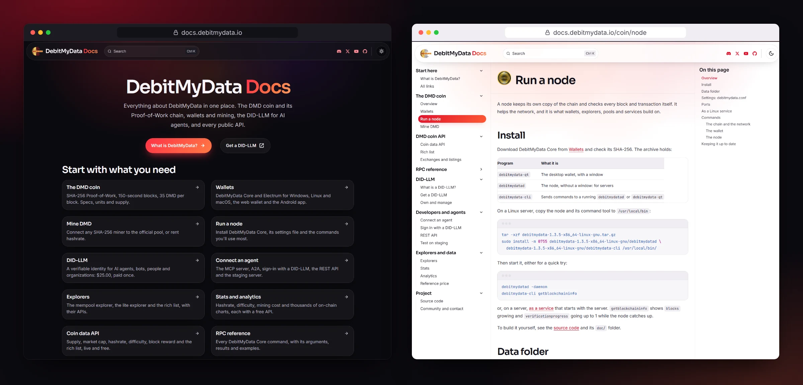

# DebitMyData Docs

The documentation website of DebitMyData, at **[docs.debitmydata.io](https://docs.debitmydata.io)**:
everything a user, a miner, a developer or an AI agent needs, in one place.

## What it covers

| Section | |
| --- | --- |
| **Start here** | What DebitMyData is, and where to begin |
| **The DMD coin** | Its specifications, wallets, running a node, mining |
| **DMD coin API** | Coin data, the rich list, and the figures exchanges and listing sites read |
| **RPC reference** | Every DebitMyData Core command, one page each, written from the node's own help |
| **DID-LLM** | The verifiable identity for AI agents, people and organizations |
| **Developers and agents** | The DebitMyData Agent Gateway: its MCP server, A2A, sign-in and REST API |
| **Explorers and data** | The explorers, the stats and analytics sites, the reference price |
| **Project** | The source code and the community |

The coin data and rich list pages show live figures, read in the visitor's browser from
[DMD Stats' API](https://stats.debitmydata.io/api/). The whole site is also published as
`/llms.txt` and `/llms-full.txt`, so that AI agents can read it in one request.

## How it is made

A static site made with [Starlight](https://starlight.astro.build) (Astro): Markdown pages in,
plain HTML pages out, with search, light and dark themes, in DebitMyData's Aurora design. Nothing
runs on the server but nginx, serving the files, so there is nothing on it to attack beyond the
web server itself.

## Working on it

- **[INSTALL.md](INSTALL.md)**: trying it on your computer, building it, and putting it online.
- **[CONTRIBUTING.md](CONTRIBUTING.md)**: editing and adding pages, and writing the RPC reference
  again after a new DebitMyData Core release.

## License

The site's code is under the MIT license ([LICENSE](LICENSE)). Its design is DebitMyData's Aurora
design (`src/styles/aurora.css`). The fonts (Sora, Inter, JetBrains Mono and Mada) are under the
SIL Open Font License (their licence texts are in [public/fonts](public/fonts)). The DebitMyData
logo and the DMD coin are DebitMyData's.
